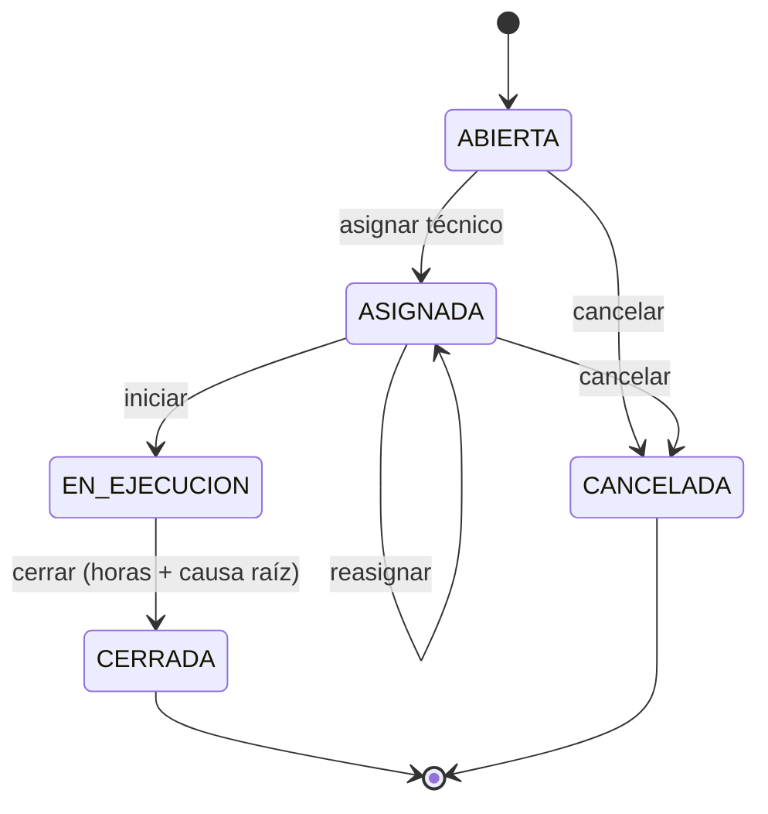

# CMMS: Gestión de Mantenimiento Industrial (Java)

Aplicación de consola en **Java 17+** que implementa un **sistema de gestión de mantenimiento (CMMS)**: registro de equipos, **órdenes de trabajo con flujo de estados**, planes de **mantenimiento preventivo** que se generan solos, control de **repuestos**, **costos** y los indicadores clásicos de confiabilidad: **MTBF, MTTR y disponibilidad**.

Aplica reglas que se viven en una planta: no se le asigna una orden mecánica a un electricista, un tanque de aire no se descuenta si la orden no está en ejecución, una falla en un equipo crítico es emergencia y un preventivo nunca lo es.

> ⚠️ Proyecto educativo / de portfolio. Los datos de ejemplo son inventados y las reglas (intervalos, prioridades) son configurables según el procedimiento de cada planta.

## Qué resuelve

| Pregunta de mantenimiento | Cómo la responde el sistema |
|---|---|
| ¿Qué hay que hacer primero? | **Backlog** ordenado por prioridad y, a igual prioridad, por antigüedad |
| ¿Qué preventivos se vencieron? | **Scheduler** que abre solo las órdenes preventivas según el plan de cada equipo |
| ¿Qué equipos me dan más problemas? | Ranking de **bad actors** por horas de parada y costo |
| ¿Qué tan confiable es esta bomba? | **MTBF, MTTR y disponibilidad** por equipo |
| ¿Cuánto cuesta mantener cada tipo de equipo? | Costos agrupados por tipo (mano de obra + repuestos) |
| ¿Cuánto trabajo es planificado? | **% de preventivo** sobre las órdenes cerradas |
| ¿Qué repuestos tengo que reponer? | Alerta de stock por debajo del mínimo |

## Flujo de la orden de trabajo



Cada transición valida el estado actual. Por ejemplo: no se inicia una orden sin asignar, no se cancela una orden en ejecución, y una correctiva **no se cierra sin indicar la causa raíz**.

## Indicadores de confiabilidad

| Indicador | Cálculo |
|---|---|
| **MTTR** (tiempo medio de reparación) | horas de parada de fallas cerradas ÷ cantidad de fallas cerradas |
| **MTBF** (tiempo medio entre fallas) | horas operativas ÷ cantidad de fallas |
| **Disponibilidad** | horas operativas ÷ horas totales desde la puesta en servicio |

Detalles que el sistema respeta: los **preventivos no cuentan como falla ni como parada**, una **falla abierta suma parada hasta el momento actual** (la disponibilidad baja mientras el equipo sigue parado) y una falla **cancelada** (falsa alarma) no cuenta.

Ejemplo de salida con los datos de ejemplo (varía con la fecha de ejecución):

```
P-101 - Bomba de carga de crudo
fallas=5  parada=58.0 h  MTTR=11.6 h  MTBF=4308.4 h  disponibilidad=99.73 %
```

## Reglas de negocio

- **Prioridad automática** según criticidad del equipo (A/B/C) y tipo de trabajo: falla en equipo A = EMERGENCIA; un preventivo nunca supera MEDIA.
- Cada orden requiere una **especialidad** (mecánico, electricista, instrumentista) definida por el tipo de equipo, y solo la puede tomar un técnico de esa especialidad.
- Un técnico no puede tener **más de 3 órdenes activas**.
- No se reporta dos veces la misma falla abierta, ni una falla con fecha futura.
- Los repuestos solo se registran en órdenes **EN_EJECUCION**; si no hay stock suficiente, **no cambia nada** (ni el stock ni la orden).
- Cada consumo guarda el **costo unitario del momento**: el historial no cambia si luego sube el precio.
- Un equipo **fuera de servicio** no genera preventivos.

## Conceptos de programación

| Concepto | Dónde se ve |
|---|---|
| **Herencia y polimorfismo** | `Equipo` → `Bomba`, `Motor`, `ValvulaControl`, `TransmisorCampo`: cada uno define su intervalo preventivo, checklist y especialidad |
| **Interfaces** | `IMantenible` (plan preventivo) e `IRepositorio<T>` (persistencia genérica) |
| **Máquina de estados** | `OrdenTrabajo` con transiciones validadas |
| **Genéricos** | `RepositorioArchivo<T>` persiste cualquier entidad |
| **Excepciones propias** | `OperacionInvalidaException`, `StockInsuficienteException`, `EntidadNoEncontradaException`, `EntidadDuplicadaException` |
| **Streams y colectores** | `groupingBy`, `summingDouble`, ordenamientos compuestos para backlog y ranking |
| **Records y enums con lógica** | `Indicadores`, `ConsumoRepuesto`, `Prioridad.calcular()` |
| **Inyección del reloj (`Clock`)** | El tiempo es controlable: las pruebas avanzan horas a mano y verifican MTBF / MTTR con números exactos |
| **Serialización** | Todo se guarda en `datos/*.dat` y se recupera, incluso una orden a medio ejecutar |
| **Separación en capas** | `GestorMantenimiento` (lógica) no imprime ni lee consola; `Main` solo hace entrada/salida |
| **Pruebas** | `PruebasCmms`: 64 verificaciones sin librerías externas |

## Estructura

```
src/
├── app/          Main.java                        → menú de consola
├── servicio/     GestorMantenimiento.java         → lógica de negocio y reportes
│                 Indicadores, RankingEquipo       → resultados de los reportes
├── modelo/       Equipo (abstracta), Bomba, Motor, ValvulaControl, TransmisorCampo
│                 OrdenTrabajo, ConsumoRepuesto, Tecnico, Repuesto
│                 Criticidad, Prioridad, Especialidad, TipoOrden, EstadoOrden, EstadoEquipo
├── interfaces/   IMantenible, IRepositorio<T>
├── repositorio/  RepositorioArchivo<T>
└── excepciones/  4 excepciones propias
test/
└── PruebasCmms.java
```

## Cómo ejecutarlo

Requisito: **JDK 17 o superior** (`javac -version` para comprobarlo).

```bash
# Compilar
mkdir bin
javac -d bin -sourcepath src src/app/Main.java

# Ejecutar
java -cp bin app.Main
```

Recorrido sugerido: **opción 15** (cargar planta de ejemplo) → **3** (generar preventivos) → **2** (reportar una falla en `P-101`) → **5, 6, 7, 8** (asignar, iniciar, usar repuesto y cerrar) → **10** (ver cómo cambian MTBF y disponibilidad) → **11** (reporte de planta).

### Pruebas

```bash
javac -d bin -sourcepath src test/PruebasCmms.java
java -ea -cp bin PruebasCmms
```

## Limitaciones

- Un solo usuario y sin autenticación; no hay roles (solicitante, planificador, técnico).
- La disponibilidad se mide desde la puesta en servicio; no hay turnos ni calendario de operación.
- Los intervalos preventivos son por **tiempo**; no hay planes por horas de uso ni por condición.
- No hay adjuntos, fotos ni firma de las órdenes.

## Posibles mejoras

- Planes preventivos por **horas de operación** y por condición (vibración, temperatura).
- Roles y autenticación (solicitante / planificador / técnico).
- Análisis de Pareto de causas raíz y curva de la bañera por equipo.
- Base de datos (SQLite / JDBC) y exportación de órdenes a PDF.
- API REST y tablero web con Spring Boot.
- Migrar las pruebas a JUnit 5 y agregar Maven o Gradle.

## Autor

**Angel Venditti** · [GitHub](https://github.com/angelvenditti15-tech)
